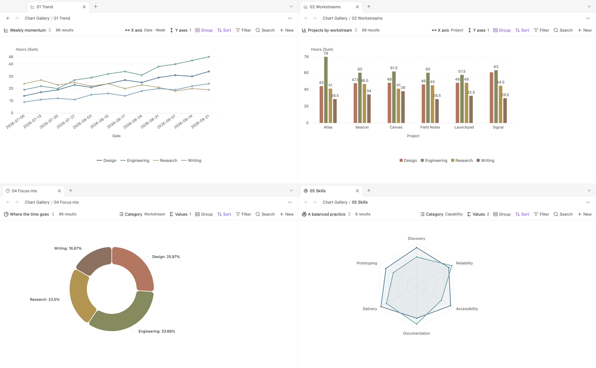
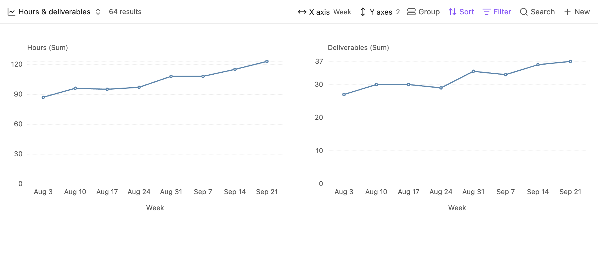
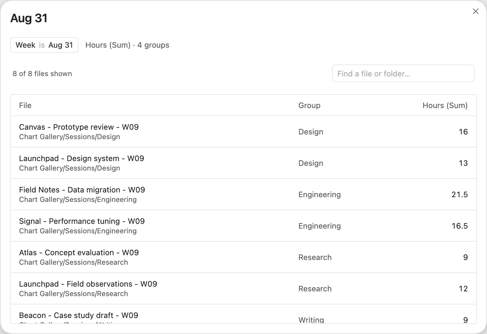

# Bases Chart Views

Interactive charts for [Obsidian Bases](https://help.obsidian.md/bases), powered by [Apache ECharts](https://echarts.apache.org/).

Six chart types display a Base's filtered results. AI Chart renders saved ECharts configurations created with Claudian.

[Install](https://community.obsidian.md/plugins/bases-chart-views) · [Documentation](https://haiqiang-zhang.github.io/obsidian-bases-charts/overview) · [UI gallery](https://haiqiang-zhang.github.io/obsidian-bases-charts/screenshots)

## Chart types

| View | Data shown |
| --- | --- |
| **Line** | Values over time or ordered categories |
| **Bar** | Category and group comparisons |
| **Stacked Area** | Group contributions to a changing total |
| **Pie** | Category shares in a donut chart |
| **Radar** | Multiple profiles across shared categories |
| **Scatter** | Individual or aggregated observations |

Each Data Chart uses the Base's current results. Select note, file, or formula properties from the toolbar, then choose an aggregation for each measure.

- **Native Bases controls.** Filter, sort, and group your notes. Use file folders, note properties, or formulas as X values.
- **Calendar grouping.** Combine timestamps by day, week, month, or year without changing the source property.
- **Independent measures.** Add and reorder Y properties, each with its own Sum, Average, Count, Min, or Max aggregation. Scatter also supports None.
- **Bar layouts.** Compare groups side by side, stack their values, or show each group's share in a 100% stacked column. Data details retain the original values.
- **Per-view palettes.** Choose Auto, Colorful, Earth, Coastal, or single-color palettes, with light and dark variants.
- **Source-file inspection.** Hover for a compact, anchored summary. Click a chart mark or supported column to open a searchable table of its source files.
- **Responsive layout.** Cartesian charts use the available width; Pie and Radar sit at the center. Multiple measures form separate charts, while Radar overlays them.

## Source files

The data dialog shows the selected category, aggregate summary, and individual file values. Search by file name or folder, load more results, and open a source note directly from its row.

On portrait phones, touch the chart to select data in a fixed preview below it. The preview stays after you lift your finger. **View data** opens the source-file drawer. Landscape phones and tablets use the chart area without the bottom preview.

[Data inspection](https://haiqiang-zhang.github.io/obsidian-bases-charts/explore-data)

## AI Chart

Use [Claudian](https://github.com/YishenTu/claudian) to create and refine a custom visualization: a heatmap, Sankey diagram, treemap, graph, gauge, or another Apache ECharts chart.

Add an **AI Chart** view, choose **Set up AI Chart**, and describe the visualization to Claudian. It writes the ECharts option into the `.base` file. This view renders its saved configuration independently of the live Bases query.

The example shows a Reference Library chart alongside the source table and Claudian conversation.

[AI Chart configuration](https://haiqiang-zhang.github.io/obsidian-bases-charts/ai-charts)

## Get started

1. Install and enable Bases Chart Views.
2. Create or open a Base and add a chart view.
3. Choose **X axis** and **Y axes** in the toolbar. Pie and Radar use **Category** and **Values**.
4. Select a measure and its aggregation. To count notes, use **file name → Count**.
5. Open **Configure view → Color palette** to choose this view's colors.

[First chart guide](https://haiqiang-zhang.github.io/obsidian-bases-charts/overview#your-first-chart) · [Axes and dates](https://haiqiang-zhang.github.io/obsidian-bases-charts/axes-and-dates) · [Groups and aggregation](https://haiqiang-zhang.github.io/obsidian-bases-charts/groups-and-aggregation)

## Installation

### Community plugins (recommended)

Install [Bases Chart Views](https://community.obsidian.md/plugins/bases-chart-views) from the Obsidian community plugin directory, then enable it. Requires **Obsidian 1.14.5 or later** and the Bases core plugin.

### BRAT

1. Install [BRAT](https://github.com/TfTHacker/obsidian42-brat).
2. In BRAT settings, choose **Add Beta Plugin**.
3. Enter `https://github.com/haiqiang-zhang/obsidian-bases-charts` and choose **Add Plugin**.
4. Enable **Bases Chart Views** in **Settings → Community plugins**.

See [release notes](https://github.com/haiqiang-zhang/obsidian-bases-charts/releases) for published versions.

## UI gallery

The [desktop gallery](https://haiqiang-zhang.github.io/obsidian-bases-charts/screenshots) and [mobile gallery](https://haiqiang-zhang.github.io/obsidian-bases-charts/mobile-gallery) show chart types and controls with fictional English sample data. Mobile images use Obsidian’s official desktop emulation. [Sample files and capture instructions](gallery/README.md) are included in the repository.

## Contributing

Report bugs in [GitHub issues](https://github.com/haiqiang-zhang/obsidian-bases-charts/issues), including your Obsidian version, plugin version, and reproduction steps.

## License

[GPL-3.0](https://choosealicense.com/licenses/gpl-3.0/)

## Acknowledgements

Originally forked from [obsidian-bases-charts-plugin](https://github.com/mProjectsCode/obsidian-bases-charts-plugin) by [mProjectsCode](https://github.com/mProjectsCode). Charts use [Apache ECharts](https://echarts.apache.org/); AI Chart configuration uses [Claudian](https://github.com/YishenTu/claudian).
