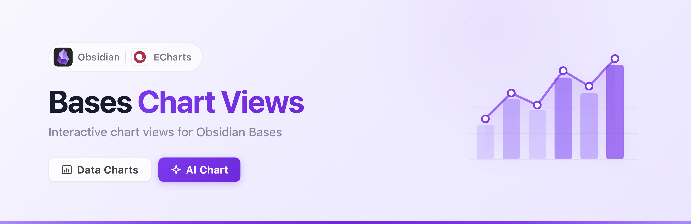
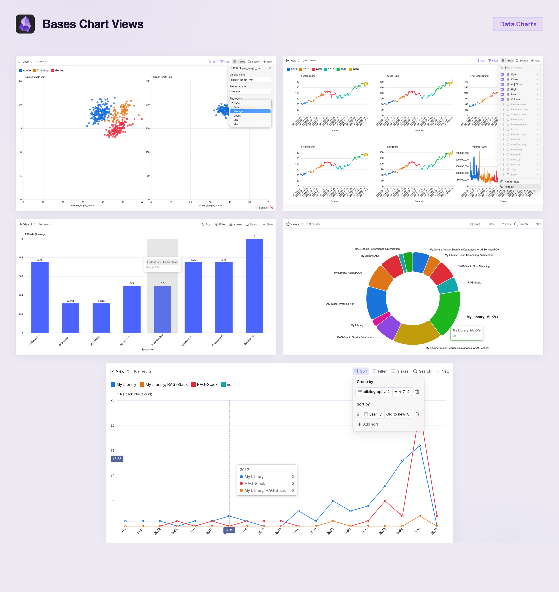
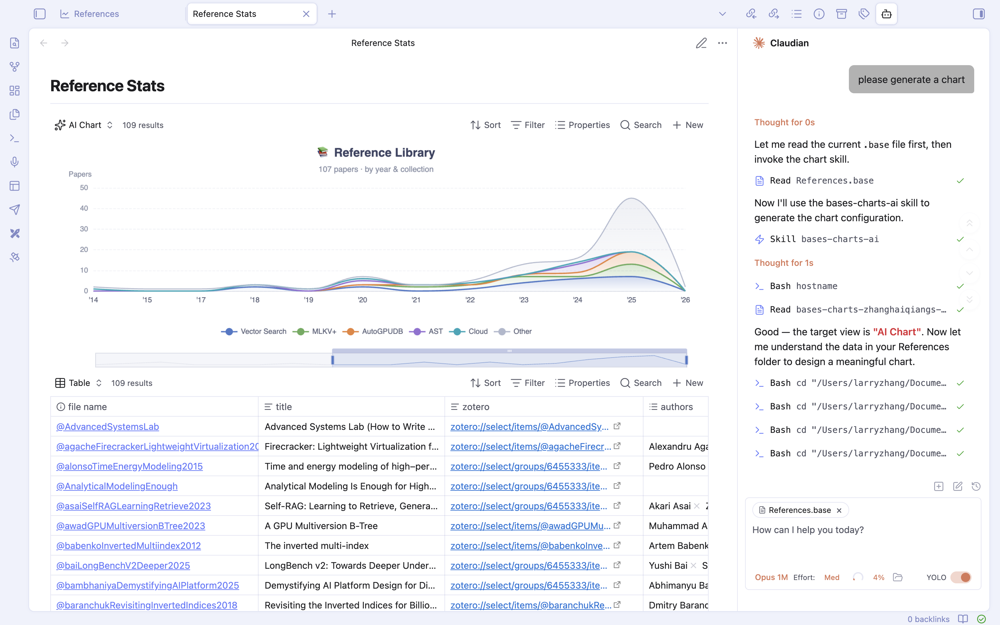

# Bases Chart Views

**Data Charts + AI Charts for [Obsidian Bases](https://help.obsidian.md/bases)**

An [Obsidian](https://obsidian.md) plugin that adds interactive chart views to Bases, powered by [Apache ECharts 6.1](https://echarts.apache.org/). Build data-driven charts manually or generate any ECharts visualization with AI via [Claudian](https://github.com/YishenTu/claudian).

### Design Philosophy

This plugin offers two fundamentally different approaches to charting:

- **Data Charts** — Each supported chart type is carefully crafted with purpose-built controls for aggregation, grouping, axis configuration, and interactivity. Rather than exposing the full complexity of ECharts, we focus on polishing a curated set of chart types and gradually expanding support.
- **AI Chart** — Fully AI-driven. You simply describe what you want in a conversation with Claudian, and it handles everything — reading your data, choosing the right chart type, and writing the complete ECharts configuration. No manual configuration needed.

## How It Works

1. Create a [Base](https://help.obsidian.md/bases) in your vault.
2. Add a new view and select a chart type — either a **Data Chart** (Scatter, Line, Stacked Area, Bar, Pie, Radar) or an **AI Chart**.
3. For Data Charts, choose **X axis** and **Y axes** in the toolbar. X supports file properties (including folder), note properties, and formulas. Add, reorder, and aggregate Y properties directly in the Y menu. Pie and Radar use **Category** and **Values** for these controls.
4. For AI Charts, install [Claudian](https://github.com/YishenTu/claudian) first. The plugin has deep integration with Claudian — you can chat with it to generate, modify, and iterate on any ECharts visualization. See [AI Chart](#ai-chart) for details.

## Data Charts

Built-in chart views that visualize Bases data with configurable axes, aggregation, and grouping.

- **Scatter** — individual data points; click to inspect their source files
- **Line** — connected data points, configurable gap handling (Leave gap or Fill with 0)
- **Stacked Area** — stacked group totals over a category, number, or date axis; click anywhere in a column to inspect its files
- **Bar** — grouped bars with optional data labels and percentage display
- **Pie** — donut chart with optional labels, percentages, and null filtering
- **Radar** — compare multiple value properties in one centered radar, with categories as spokes and optional groups as additional profiles

### Features

- Multiple Y axes: each Y property produces a separate chart (Radar overlays the selected properties), with responsive columns and vertical scrolling when needed
- Per-property aggregation: set Sum, Average, Count, Min, Max (or None for Scatter) independently for each Y axis
- Sync Y axes and min/max override for Bar, Line, Stacked Area, and Scatter charts
- Native Group menu: groups become colored series, respecting selected groups and manual group order
- Per-view color palettes: Auto, Colorful, Earth, Coastal, and nine single-color palettes, each adapted for light and dark themes
- Compact, stationary tooltips with the X property and group totals; click a chart column to explore its files in a searchable data table
- X axis sorting via Bases Sort configuration
- Date grouping for X: Exact time, Day, Week, Month, or Year
- Native property and formula editors, available from each property row in the axis menus

X, Y, and Group sit together in the toolbar. Pie and Radar show Category and Values instead of axis controls. Open **Configure view** from the view selector on the left and choose **Color palette**. The searchable dropdown previews each palette with color swatches and shows the current selection first with a checkmark. The selection is saved with that view in the `.base` file; other views keep their own colors. Auto preserves the soft default palette. Chart appearance and applicable Y scale settings remain in the view settings. Existing charts keep their previous Y property selection until you edit it in the new Y menu. The vault root appears as `/` when using folder as X.

For a date or datetime X property, choose **Date grouping → Day** to combine timestamps from the same day. Week, Month, and Year are also available. Grouping uses local calendar dates, with weeks starting on Monday; only periods containing records are shown. Choose **Exact time** to retain individual timestamps. The setting belongs to the selected X property in that view.

Click a property name to select it, or its right-hand arrow to open Obsidian’s native property editor. **Add formula** opens the native formula editor with completion and validation. A valid new formula is selected when you leave the editor. **Back** returns to the X or Y menu you came from, with the current selection at the top.

Stacked Area fills missing group values with zero and stacks positive and negative values separately. Radar needs at least three categories with values. Its default shared scale preserves differences between categories; choose **Per category** when comparing profiles across categories with different ranges. Missing radar values are plotted at zero and shown as missing in the tooltip. Click a radar profile to inspect its files by category.

## AI Chart

Generate any ECharts visualization using [Claudian](https://github.com/YishenTu/claudian). The AI Chart view supports the full ECharts option spec — line, bar, scatter, pie, radar, heatmap, treemap, sunburst, graph, sankey, gauge, funnel, candlestick, boxplot, parallel, and more.

AI Chart renders its saved ECharts configuration independently of the Bases query, so its toolbar only shows the view selector.

AI Chart options follow the [ECharts 6.1 API](https://github.com/apache/echarts/releases/tag/6.1.0). For older options that use `axis.startValue` to fix the axis minimum, also set `axis.min` to the same value; `startValue` no longer sets it implicitly.

### Setup

1. Add an **AI Chart** view to your Base.
2. Click **Set up AI Chart** to install the Claudian skill (requires [Claudian](https://github.com/YishenTu/claudian)).
3. Ask Claudian to generate a chart — it reads your data and writes the ECharts configuration directly to the `.base` file.
4. The chart renders automatically. Edit via Claudian to iterate on the visualization.

## General

- Bar, line, stacked area, and scatter charts sit directly below the native toolbar with narrow chart margins; pie and radar charts sit at the center
- Legends stay below the charts, and smaller panes scroll naturally
- Light and dark theme support
- Mobile-optimized layout

## Installation

### Community plugins (recommended)

Install [Bases Chart Views](https://community.obsidian.md/plugins/bases-chart-views) from the Obsidian community plugin directory, then enable it.

### BRAT

1. Install the [BRAT](https://github.com/TfTHacker/obsidian42-brat) plugin.
2. In BRAT settings, click **Add Beta Plugin**.
3. Enter `https://github.com/haiqiang-zhang/obsidian-bases-charts` and click **Add Plugin**.
4. Enable **Bases Chart Views** in Settings > Community plugins.

## License

[GPL-3.0](https://choosealicense.com/licenses/gpl-3.0/)

## Acknowledgements

This plugin started as a fork of [obsidian-bases-charts-plugin](https://github.com/mProjectsCode/obsidian-bases-charts-plugin) by [mProjectsCode](https://github.com/mProjectsCode), and has since been fully rewritten from scratch using native TypeScript and [Apache ECharts](https://echarts.apache.org/). AI Chart is powered by [Claudian](https://github.com/YishenTu/claudian).

## Contributions

Contributions are always welcome. If you have an idea, feel free to open a feature request under the issue tab or create a pull request.
