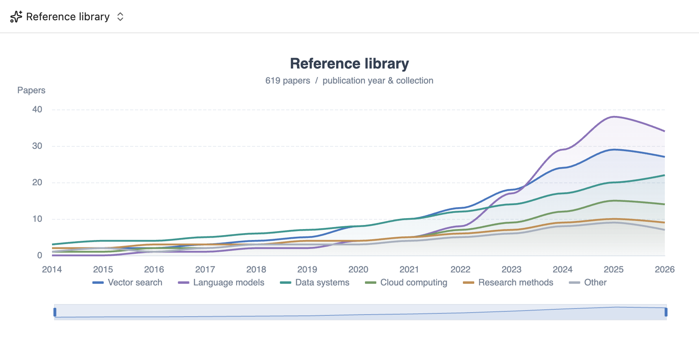

# Bases Chart Views

Interactive charts for [Obsidian Bases](https://help.obsidian.md/bases), powered by [Apache ECharts](https://echarts.apache.org/).

Compare categories, follow a timeline, and open the notes behind every number. Choose from six Data Chart views, or use Claudian to create a custom ECharts visualization.

[**Get the plugin**](https://community.obsidian.md/plugins/bases-chart-views) · [Documentation](https://haiqiang-zhang.github.io/obsidian-bases-charts/overview) · [UI Gallery](https://haiqiang-zhang.github.io/obsidian-bases-charts/screenshots)

## Charts for your notes

| View | Use it to… |
| --- | --- |
| **Line** | Follow change over time |
| **Bar** | Compare categories and groups |
| **Stacked Area** | See how groups contribute to a changing total |
| **Pie** | Show the composition of a total in a centered donut |
| **Radar** | Compare profiles across several dimensions |
| **Scatter** | Explore relationships and individual observations |

Each Data Chart uses the Base's current results. Select note, file, or formula properties from the toolbar, then choose an aggregation for each measure.

- **Native Bases controls.** Filter, sort, and group your notes. Use file folders, note properties, or formulas as X values.
- **Calendar grouping.** Combine timestamps by day, week, month, or year without changing the source property.
- **Independent measures.** Add and reorder Y properties, each with its own Sum, Average, Count, Min, or Max aggregation. Scatter also supports None.
- **A palette for every view.** Preview Auto, Colorful, Earth, Coastal, and single-color palettes. Each has light and dark variants.
- **Source-file inspection.** Hover for a compact, anchored summary. Click a chart mark or supported column to open a searchable table of its source files.
- **Responsive layout.** Cartesian charts use the available width; Pie and Radar sit at the center. Multiple measures form separate charts, while Radar overlays them.

## From a chart to its source

The data dialog shows the selected category, aggregate summary, and individual file values. Search by file name or folder, load more results, and open a source note directly from its row.

[Explore the data →](https://haiqiang-zhang.github.io/obsidian-bases-charts/explore-data)

## AI Chart

Use [Claudian](https://github.com/YishenTu/claudian) to create and refine a custom visualization: a heatmap, Sankey diagram, treemap, graph, gauge, or another Apache ECharts chart.

Add an **AI Chart** view, choose **Set up AI Chart**, and describe the visualization to Claudian. It writes the ECharts option into the `.base` file. This view renders its saved configuration independently of the live Bases query.

The gallery example uses a saved configuration with fictional reference-library data. It demonstrates rendering a custom option; it does not show a Claudian generation session.

[AI Chart setup and behavior →](https://haiqiang-zhang.github.io/obsidian-bases-charts/ai-charts)

## Get started

1. Install and enable Bases Chart Views.
2. Create or open a Base and add a chart view.
3. Choose **X axis** and **Y axes** in the toolbar. Pie and Radar use **Category** and **Values**.
4. Select a measure and its aggregation. To count notes, use **file name → Count**.
5. Open **Configure view → Color palette** to choose this view's colors.

[First chart guide](https://haiqiang-zhang.github.io/obsidian-bases-charts/overview#your-first-chart) · [Axes and dates](https://haiqiang-zhang.github.io/obsidian-bases-charts/axes-and-dates) · [Groups and aggregation](https://haiqiang-zhang.github.io/obsidian-bases-charts/groups-and-aggregation)

## Installation

### Community plugins (recommended)

Install [Bases Chart Views](https://community.obsidian.md/plugins/bases-chart-views) from the Obsidian community plugin directory, then enable it. Requires **Obsidian 1.12.0 or later** and the Bases core plugin.

### BRAT

1. Install [BRAT](https://github.com/TfTHacker/obsidian42-brat).
2. In BRAT settings, choose **Add Beta Plugin**.
3. Enter `https://github.com/haiqiang-zhang/obsidian-bases-charts` and choose **Add Plugin**.
4. Enable **Bases Chart Views** in **Settings → Community plugins**.

The documentation and gallery cover **0.5.0**. Update the plugin to use all features shown here, and check the [release notes](https://github.com/haiqiang-zhang/obsidian-bases-charts/releases) for changes between versions.

## English UI gallery

The 15 screenshots cover all six chart types, multiple measures, calendar grouping, the native formula editor, per-view palettes, column interactions, source files, and dark mode. The overview follows eight weeks of a fictional studio's work; the AI example shows a custom reference-library timeline. All labels and sample data are in English, with no personal vault content.

[Browse the gallery](https://haiqiang-zhang.github.io/obsidian-bases-charts/screenshots) · [Download the PNG set](https://haiqiang-zhang.github.io/obsidian-bases-charts/gallery/bases-chart-views-gallery.zip) · [Local gallery and sample data](gallery/README.md)

## Contributing

Ideas, bug reports, and pull requests are welcome. Open an [issue](https://github.com/haiqiang-zhang/obsidian-bases-charts/issues) with your Obsidian version, plugin version, and steps to reproduce the behavior.

## License

[GPL-3.0](https://choosealicense.com/licenses/gpl-3.0/)

## Acknowledgements

This plugin started as a fork of [obsidian-bases-charts-plugin](https://github.com/mProjectsCode/obsidian-bases-charts-plugin) by [mProjectsCode](https://github.com/mProjectsCode), and has since been fully rewritten from scratch using native TypeScript and [Apache ECharts](https://echarts.apache.org/). AI Chart is powered by [Claudian](https://github.com/YishenTu/claudian).
